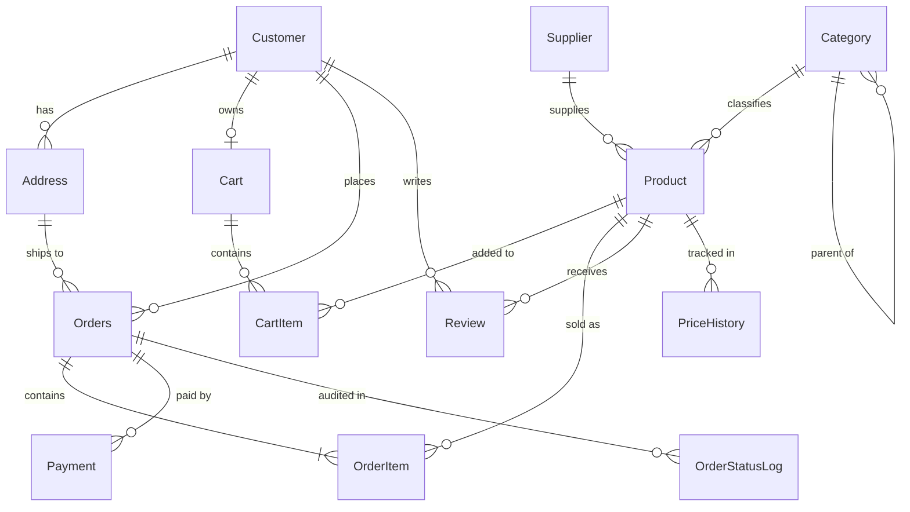
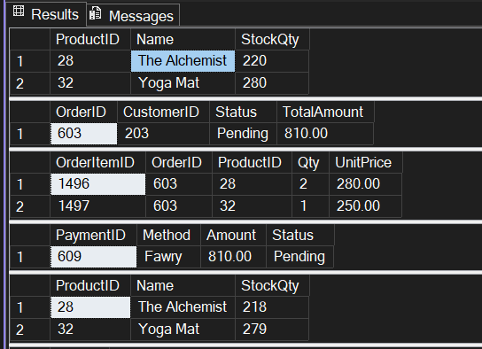
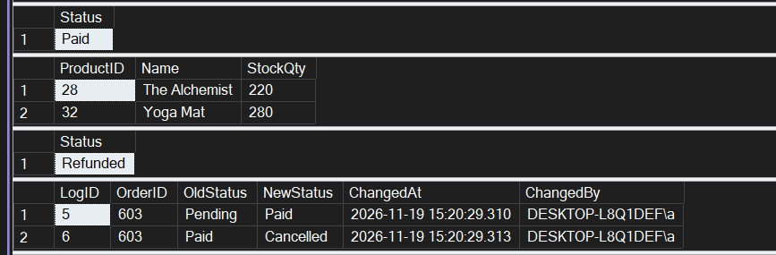
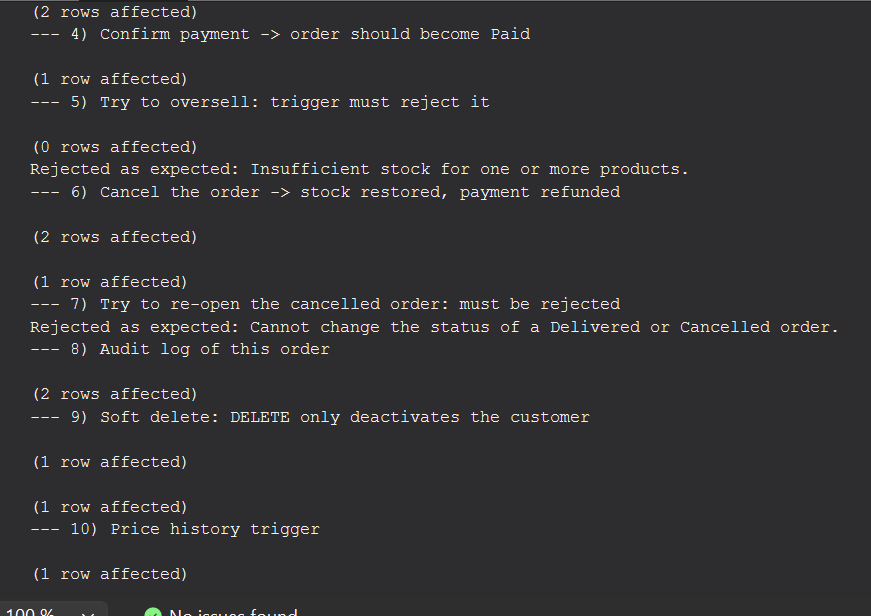
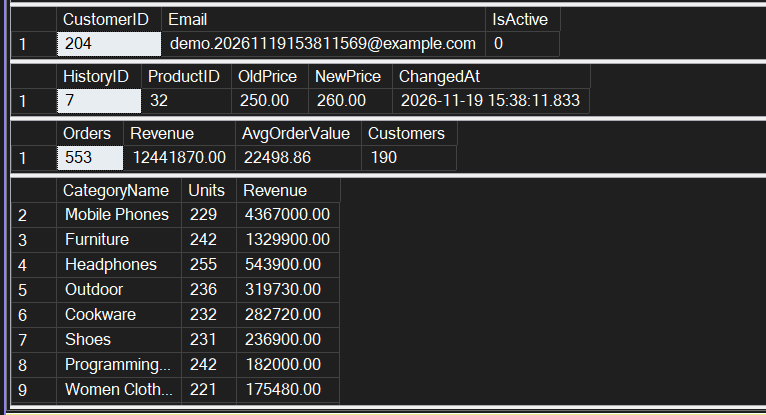

# E-Commerce Database (SQL Server)

A relational database for an online store, built in **T-SQL** on SQL Server. The project focuses on **enforcing business rules inside the database**: constraints, triggers and transactional stored procedures keep orders, stock and payments consistent no matter which application writes to it.

## Highlights

- **11 core tables** in 3NF, with PK/FK/UNIQUE/CHECK/DEFAULT constraints and a self-referencing category tree
- **Order placement in one transaction**: cart → order → order items → pending payment, with full rollback on any failure
- **Triggers** for stock control, order-status audit log, payment-driven status changes, price history and soft delete
- **Reporting layer**: views, window functions (`RANK`, `NTILE`, `LAG`, running totals), `PIVOT` and `MERGE`
- **Generated sample data** (200 customers, 36 products, 600 orders and related rows) so every query returns meaningful results

## Tech

SQL Server 2016 SP1 or later (uses `CREATE OR ALTER` and `DROP INDEX IF EXISTS`) · T-SQL · SSMS

## Entity Relationship Diagram



| Table | Purpose |
|---|---|
| Customer, Address | Accounts and shipping addresses (one default address per customer, enforced by a filtered unique index) |
| Category, Supplier, Product | Catalog; categories form a parent/child tree |
| Cart, CartItem | One active cart per customer |
| Orders, OrderItem | Orders and their lines; `UnitPrice` stores the price at purchase time |
| Payment | Payment attempts with method and status |
| Review | One review per customer per product, rating 1-5 |
| OrderStatusLog, PriceHistory | Audit tables filled by triggers |

## Business Logic

### Order lifecycle

1. `usp_AddToCart` validates the customer, product and available stock, and creates the cart if needed.
2. `usp_PlaceOrder` runs in a single transaction: validates the cart and address, creates the order, copies cart items using the current price, applies the loyalty discount from `fn_GetCustomerDiscount` (5% after 3 successful orders, 10% after 5), creates a pending payment and empties the cart. Any failure rolls everything back.
3. `trg_OrderItem_ReduceStock` rejects an order line if stock is insufficient, otherwise reduces stock.
4. `usp_ConfirmPayment` completes the payment and `trg_Payment_MarkOrderPaid` moves the order from `Pending` to `Paid`.
5. `usp_UpdateOrderStatus` moves the order to `Shipped` / `Delivered`; `trg_Orders_StatusChange` writes every change to `OrderStatusLog`.
6. `usp_CancelOrder` is allowed only before shipping; stock is restored by trigger and the payment becomes `Refunded` or `Failed`.
7. `usp_AddReview` allows a review only for products from a delivered order, once per product.

### Other rules

- Orders in `Delivered` or `Cancelled` status are final.
- Deleting a customer is a **soft delete** (`INSTEAD OF DELETE` sets `IsActive = 0`) so order history is preserved.
- Every price change is recorded in `PriceHistory`.
- `CHECK` constraints protect price > 0, stock >= 0, rating 1-5 and the allowed status / payment method values.

### Triggers

| Trigger | Type | What it does |
|---|---|---|
| `trg_OrderItem_ReduceStock` | AFTER INSERT | Blocks overselling, reduces stock (set-based, handles multi-row inserts) |
| `trg_Orders_StatusChange` | AFTER UPDATE | Blocks changes to final orders, logs status changes, restores stock on cancel |
| `trg_Payment_MarkOrderPaid` | AFTER INSERT/UPDATE | Completed payment marks a pending order as Paid |
| `trg_Product_PriceHistory` | AFTER UPDATE | Logs old and new price |
| `trg_Customer_SoftDelete` | INSTEAD OF DELETE | Deactivates instead of deleting |

### Stored procedures

`usp_AddCustomer` · `usp_AddToCart` · `usp_PlaceOrder` · `usp_ConfirmPayment` · `usp_UpdateOrderStatus` · `usp_CancelOrder` · `usp_AddReview` · `usp_RestockProduct` · `usp_SalesReport`

## Reporting

Views: `vw_OrderDetails`, `vw_ProductSales`, `vw_CustomerSummary`, `vw_ProductRatings`, `vw_LowStock`
Functions: `fn_GetCustomerDiscount` (scalar), `fn_GetCustomerOrders` (inline table-valued)

Example analyses in `sql/02_indexes_views_functions_queries.sql`:

- Top products by revenue
- Customer ranking with `RANK`, `DENSE_RANK` and `NTILE`
- Best-selling product per category (`ROW_NUMBER` + `PARTITION BY`)
- Monthly revenue with running total and month-over-month growth (`LAG`)
- Monthly revenue per main category using `PIVOT`
- Payment method share, cancellations by city, highly rated products, abandoned carts
- `MERGE` upsert from a staging table

## Repository structure

```
ecommerce-sql-project/
├── README.md
└── sql/
    ├── 01_schema_and_seed_data.sql
    ├── 02_indexes_views_functions_queries.sql
    └── 03_triggers_procedures_tests.sql
```


## How to run

1. Open SQL Server Management Studio.
2. Run the scripts **in order**: `01` creates the `ECommerceDB` database (dropping it first if it exists), the tables and the sample data; `02` adds indexes, views, functions and the report queries; `03` adds the audit tables, triggers, procedures and a test scenario.
3. The test scenario at the end of `03` walks through a full order flow (new customer → cart → order → payment → oversell attempt → cancellation → illegal status change) and prints the result of every step.

Sample data is generated by script, so names, dates and amounts differ slightly on each run.


## Test results

The test scenario at the end of `03_triggers_procedures_tests.sql` produces the following output.

### 1. Placing an order reduces stock


### 2. Payment, cancellation, stock restored and audit log


### 3. Business rules rejected by triggers


### 4. Soft delete, price history and sales report


## Known limitations and possible improvements

- **Concurrency:** two simultaneous orders for the last unit could both pass the stock check before the stock is reduced. Using `UPDLOCK` hints or a stricter isolation level in the trigger would close this gap.
- Seeded historical orders do not reduce stock; the stock trigger applies to new orders.
- No application layer: the project is a database-only deliverable.

## Author

`<ehab elfikey>` · `<LinkedIn : https://www.linkedin.com/in/ehab-el-fikey-49a57b434?utm_source=share_via&utm_content=profile&utm_medium=member_android / email : ehabelfikey@gmail.com>`
